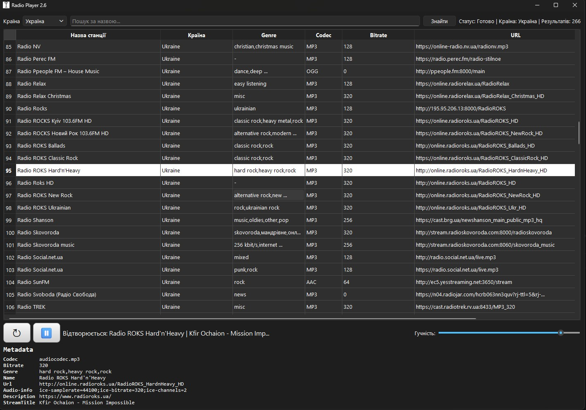

# RadioPlayer

RadioPlayer is a desktop internet-radio application written in Python with PyQt6. It searches the public [Radio Browser](https://www.radio-browser.info/) catalogue and plays HTTP(S) audio streams.

The interface is currently in Ukrainian.

## Screenshot



## Features

- Search stations by country and name.
- Browse up to 2,000 available stations per search.
- Sort stations by bitrate and stream URL.
- Play, pause, restart, and adjust stream volume.
- Display stream metadata, including codec, bitrate, genre, URL, and the current track title when available.
- Load stations and countries in background threads to keep the interface responsive.
- Continue to offer a short country list if the countries API is unavailable.

## Requirements

- Python 3.10 or later
- Windows, macOS, or Linux with multimedia support provided by Qt
- Internet connection for station discovery and playback

Python dependencies are listed in `requirements.txt`.

## Continuous integration

GitHub Actions validates every push and pull request on Windows, the primary
target platform for this application. The workflow installs the package with
development tools, runs Ruff, compiles the source, and executes the offline
unit-test suite with a 70% coverage floor for deterministic core modules.

Pushing a version tag such as `v2.7.0` starts a separate release workflow. It
runs the tests, builds `RadioPlayer.exe`, generates a SHA-256 checksum, and
publishes both files as GitHub Release assets. This keeps distributed binaries
traceable to the exact tagged source revision.

## Installation

Create and activate a virtual environment:

```powershell
python -m venv .venv
.\.venv\Scripts\Activate.ps1
```

Install the application dependencies:

```powershell
python -m pip install -r requirements.txt
```

## Run

```powershell
python radio.py
```

If you use an existing virtual environment, invoke its interpreter directly:

```powershell
.\.venv\Scripts\python.exe radio.py
```

## Tests

The test suite runs without internet access and covers API response handling,
duplicate stream removal, network errors, metadata escaping, and table sorting.

```powershell
python -m unittest discover -s tests -v
```

## Build a Windows executable

For a reproducible local release build, install the build dependency and run:

```powershell
python -m pip install pyinstaller
./scripts/build_release.ps1
```

The script uses the maintained `RadioPlayer.spec`, creates
`dist/RadioPlayer.exe`, and writes `dist/RadioPlayer.exe.sha256`. Verify a
downloaded release on Windows with:

```powershell
Get-FileHash -Algorithm SHA256 .\RadioPlayer.exe
```

Publish generated executables as GitHub Release assets instead of adding them to
Git. The local `RadioPlayer_v2.exe` is intentionally ignored.

## Architecture

The application separates I/O, presentation, and playback responsibilities:

```text
Radio Browser API -> api.py -> RadioApp -> station_table.py -> QTableWidget
                                    |
                                    +-> playback.py -> Qt Multimedia
                                    +-> metadata_view.py -> escaped rich text
```

- `api.py` validates API payloads and runs network work in Qt worker threads.
- `station_table.py` inserts large search results in event-loop batches so the UI stays responsive.
- `playback.py` owns Qt multimedia objects and rejects stale background metadata-probe results.
- `metadata_view.py` escapes stream-provided values before they reach rich text.
- `app.py` coordinates UI actions and persists non-sensitive preferences through `QSettings`.

The saved preferences are volume, selected country, and the last selected
station. A saved stream is shown but never auto-played on startup.

## Project files

| File | Purpose |
| --- | --- |
| `radio.py` | Application entry point. |
| `radio_player/api.py` | Radio Browser API client and background loaders. |
| `radio_player/metadata.py` | Stream metadata parsing and normalization. |
| `radio_player/playback.py` | Qt multimedia lifecycle and safe title probing. |
| `radio_player/station_table.py` | Responsive station-table presentation. |
| `radio_player/metadata_view.py` | Escaped metadata rendering. |
| `radio_player/widgets.py` | Custom Qt table widgets. |
| `radio_player/app.py` | Main-window UI and playback controller. |
| `requirements.txt` | Runtime Python dependencies. |
| `tests/test_radio.py` | Offline unit tests. |
| `RadioPlayer.spec` | PyInstaller build configuration. |
| `scripts/build_release.ps1` | Reproducible Windows executable build and SHA-256 generation. |
| `.github/workflows/tests.yml` | Lint, compilation, test, and coverage checks. |
| `.github/workflows/release.yml` | Tagged Windows Release publication. |
| `radio_antenna_graphite.ico` | Icon used for the Windows executable. |

## Notes

Station details and stream availability are supplied by third-party radio stations through the Radio Browser API. A stream may be unavailable, change its URL, or omit metadata at any time.
